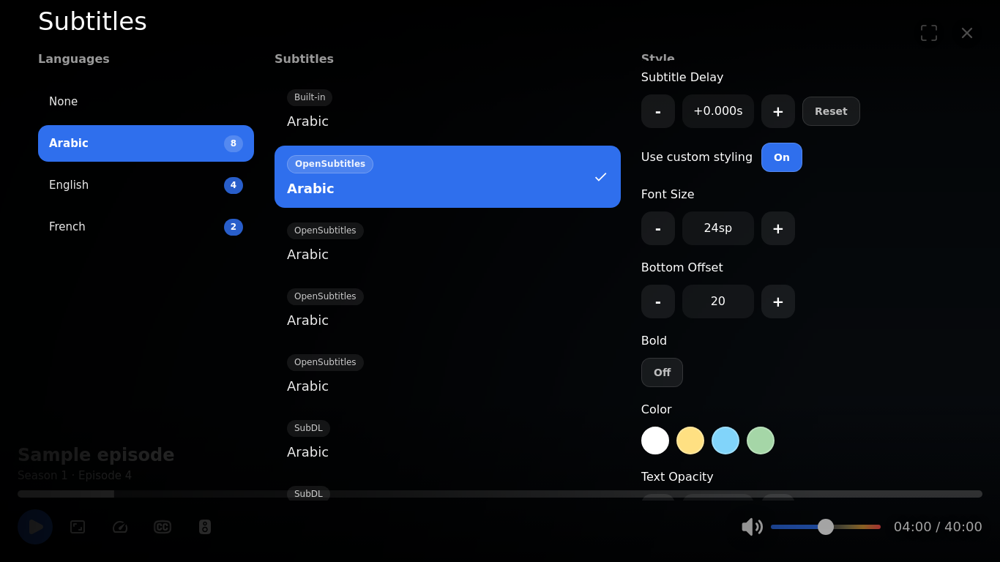
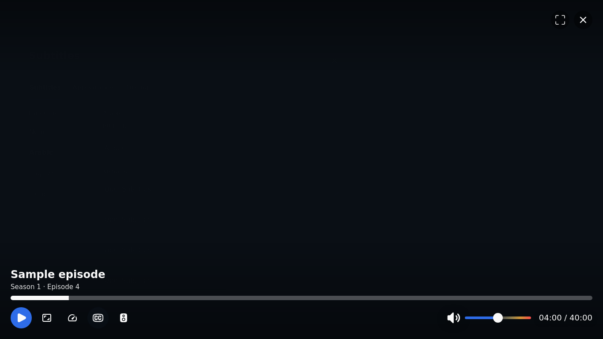
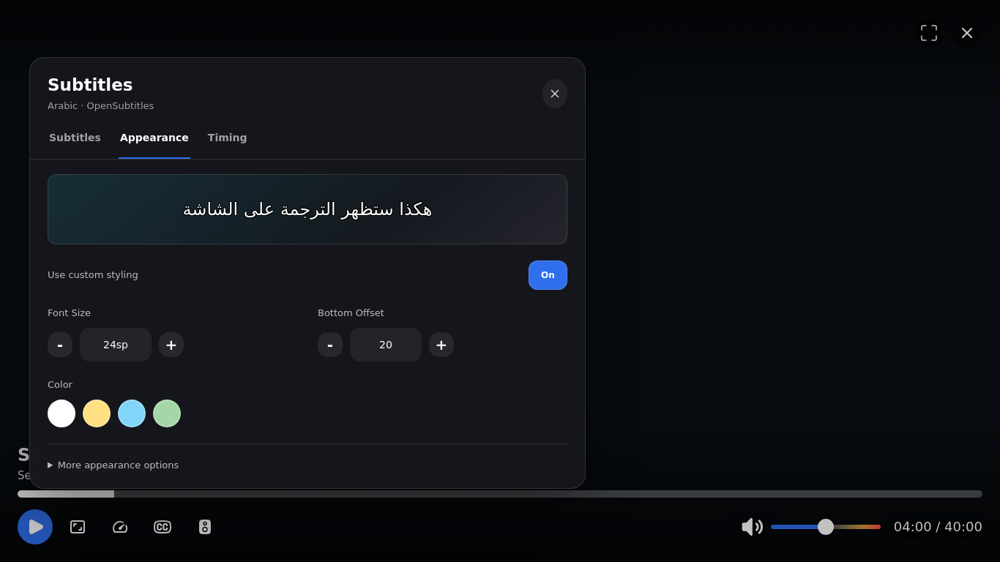
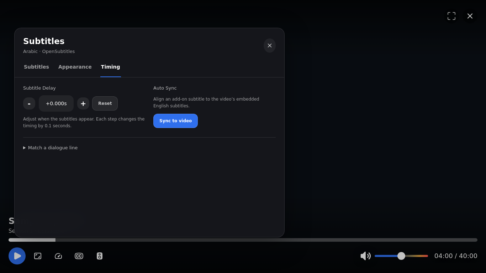
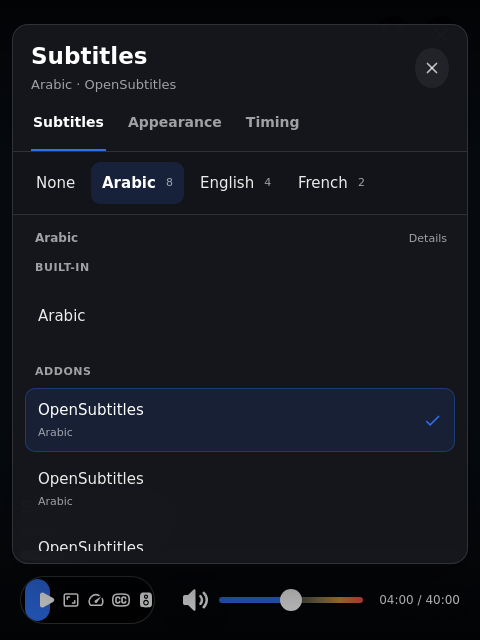

# Desktop subtitle menu

The Windows native player opens subtitle selection in a compact panel with three tabs:

- **Subtitles:** language list, separate built-in and add-on groups, and the current selection. Provider names are prominent in add-on rows. **Details** reveals release names; hovering a row also shows its full information.
- **Appearance:** a sample subtitle preview, font size, bottom offset and color. Bold, opacity and outline controls sit under **More appearance options**.
- **Timing:** manual delay and **Sync to video**. **Match a dialogue line** expands the existing capture/reload and cue-selection controls.

Synchronization still requires an add-on subtitle and readable embedded English. Moving the controls does not change the alignment engine or its validation. Subtitle-selection commands, source ranking, saved preferences and style persistence continue through the existing native player bridge.

Language rows become a horizontal strip in narrow windows. Tab arrows, Home/End, keyboard focus containment, Escape, an explicit close button and outside-click dismissal are supported. Player state refreshes preserve focused subtitle rows and list scroll position.

## Review images

These images render the actual bundled player HTML/CSS/JavaScript in Chromium with synthetic subtitle data. They are not captures of the installed Windows application.

| Before | Selection |
| --- | --- |
|  |  |

| Appearance | Timing |
| --- | --- |
|  |  |

## Verification

`node scripts/test_player_subtitle_menu.cjs` runs against the real player resources. Provide Playwright through Node's module search path (`NODE_PATH`) and install its Chromium browser. `NUVIO_UI_BROWSER_PATH` optionally points to an existing Chromium executable; `NUVIO_UI_SCREENSHOTS` optionally writes review images.

Checks cover native selection indices, timing/style commands, disabled sync states, state refreshes, keyboard navigation, fetch/loading states, long Arabic strings and narrow/short layouts. The **Subtitle menu UI** GitHub workflow installs isolated test tools and uploads fresh images. Playwright is a development-only tool and is not included in the app.

The browser checks do not replace a Windows WebView2 playback test. Rebuild the MSI after updating the branch to include the new resources.
